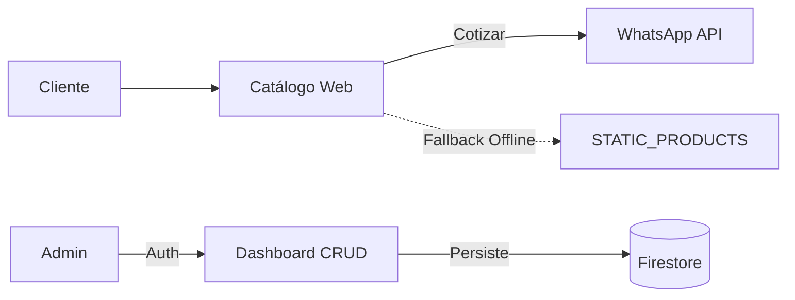
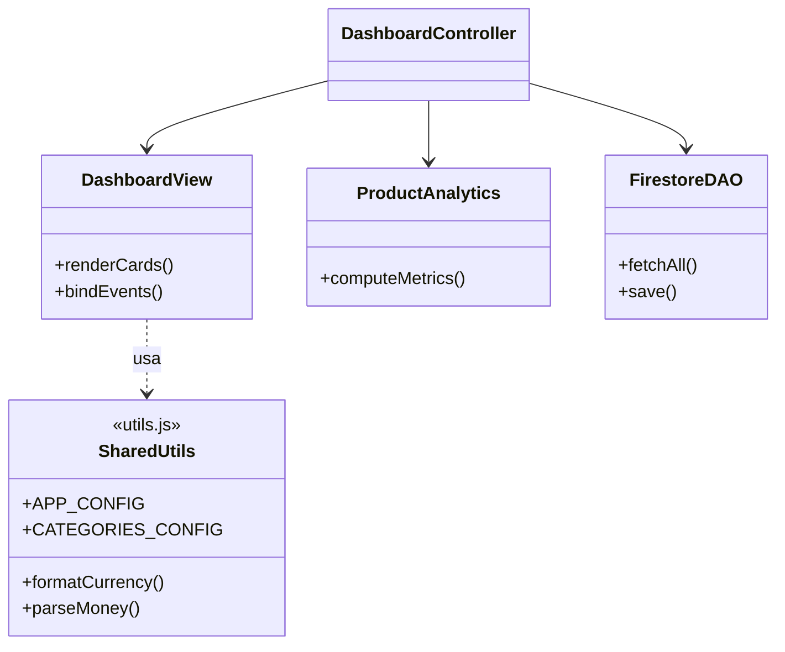
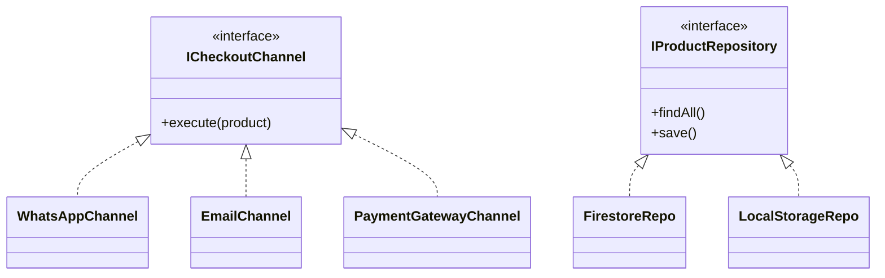
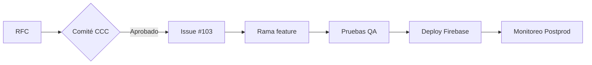
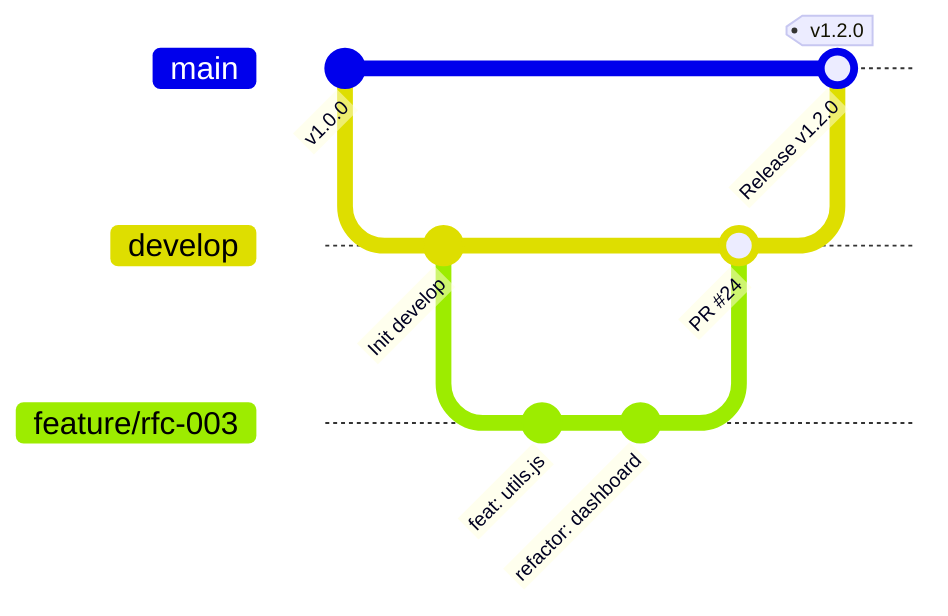

# EVALUACIÓN T3 — MANTENIMIENTO Y EVOLUCIÓN DE SOFTWARE
## GUÍA MAESTRA DE DIAPOSITIVAS (MÁXIMO 10 SLIDES)
**Proyecto:** Sistema Web Comercial y de Gestión de Inventario — JL DATA PRO  
**Integrantes:** 5 Miembros | **Tiempo Límite:** 8 Minutos (~95 segundos por miembro)  
**Tecnologías:** HTML5, CSS3 Modular, JS ES6+, Firebase Hosting, Firebase Auth, Cloud Firestore  
**Formato:** Puntos directos para diapositivas (*Bullet points*), diagramas compactos y guion rápido de exposición.

---

```mermaid
timeline
    title Distribución de los 8 Minutos (5 Integrantes - 10 Diapositivas)
    Miembro 1 (0:00 - 1:35) : Slide 1 (Proyecto) : Slide 2 (Diagnóstico y Caso Real)
    Miembro 2 (1:35 - 3:10) : Slide 3 (DRY y SRP) : Slide 4 (OCP e IoC)
    Miembro 3 (3:10 - 4:45) : Slide 5 (Resultados ISO 25010) : Slide 6 (SCIs y Línea Base)
    Miembro 4 (4:45 - 6:20) : Slide 7 (Flujo de Cambio RFC) : Slide 8 (GitFlow)
    Miembro 5 (6:20 - 8:00) : Slide 9 (Commits Semánticos) : Slide 10 (Releases, Tags y Cierre)
```

---

### Diapositiva 1: Descripción General del Proyecto
**Expositor:** Miembro 1 | **Tiempo:** ~45 seg | **Punto 1 del Temario**

* **Giro del Negocio:** Empresa tecnológica en Los Olivos (Lima) dedicada a la venta de computadoras armadas, laptops y servicio técnico especializado.
* **Modelo Operativo:**
  - **Frontend Público:** Catálogo reactivo, buscador predictivo y cotización asistida directa a **WhatsApp API** (`+51 976 330 703`).
  - **Dashboard Administrativo:** Módulo CRUD protegido con **Firebase Authentication** y persistencia en tiempo real con **Cloud Firestore**.
  - **Resiliencia Operativa:** Arquitectura con fallback automático a catálogo estático (`STATIC_PRODUCTS`) ante caídas de red o latencia de la nube.
* **Arquitectura de Alto Nivel:**



> **Espacio para PPT:** *[Insertar captura de pantalla de la página principal index.html y logo]*  
> **Guion de Exposición:** *"JL DATA PRO es una plataforma web comercial que integra catálogo de equipos con cotización automatizada por WhatsApp y un panel administrativo en la nube, garantizando resiliencia operativa offline ante cualquier contingencia de red."*

---

### Diapositiva 2: Diagnóstico del Software Inicial (Deuda Técnica)
**Expositor:** Miembro 1 | **Tiempo:** ~50 seg | **Punto 2 del Temario**

* **Principales "Code Smells" Detectados:**
  - **Violación DRY:** Constantes de categorías, imágenes fallback (`DEFAULT_IMAGES`) y formateo de moneda duplicados en 3 archivos.
  - **Violación SRP:** Archivo monolítico `dashboard.js` (272 líneas) mezclando validación DOM, cálculo de stock y llamadas a Firestore.
  - **Violación OCP:** Cotización fijada exclusivamente a WhatsApp sin soporte para otros canales.
  - **Violación IoC:** Dependencia dura del CDN de Firebase sin abstracción de repositorio.
* **Caso Real en Producción:**
  - Los productos *"PC de Escritorio Oficina"* y *"Lenovo IdeaPad 3"* no se mostraban en vivo.
  - **Causa Raíz:** `products-loader.js` sobrescribía destructivamente el catálogo en memoria con los datos de Firestore (`catalog = products`), descartando los productos estáticos no sincronizados.

> **Espacio para PPT:** *[Insertar fragmento de código antes de la refactorización o captura de Firestore]*  
> **Guion de Exposición:** *"El software inicial era funcional pero frágil: duplicaba código en 3 archivos y un fallo en la sincronización de Firestore ocultaba productos válidos en el catálogo comercial."*

---

### Diapositiva 3: Refactorización: Principios DRY y Responsabilidad Única (SRP)
**Expositor:** Miembro 2 | **Tiempo:** ~45 seg | **Punto 3 del Temario**

* **Solución DRY — Módulo Centralizado (`utils.js`):**
  - Centralización inmutable (`Object.freeze`) de configuraciones (`APP_CONFIG`, `CATEGORIES_CONFIG`).
  - Funciones utilitarias puras: `formatCurrency()`, `parseMoney()`, `getDefaultImage()`.
* **Solución SRP — Descomposición en 3 Capas:**
  - **`DashboardView`:** Exclusiva manipulación de eventos y renderizado DOM.
  - **`ProductAnalyticsService`:** Lógica de negocio y cálculo financiero de inventario en soles.
  - **`FirestoreProductDAO`:** Comunicación asíncrona exclusiva con la base de datos.



> **Guion de Exposición:** *"Aplicamos DRY extrayendo un módulo central utils.js para eliminar la duplicidad, y aplicamos SRP dividiendo el dashboard monolítico en vista, lógica de cálculo y persistencia."*

---

### Diapositiva 4: Refactorización: Abierto/Cerrado (OCP) e Inversión de Control (IoC)
**Expositor:** Miembro 2 | **Tiempo:** ~50 seg | **Punto 4 del Temario**

* **Solución OCP — Patrón Strategy (Extensibilidad Comercial):**
  - Interfaz abstracta `ICheckoutChannel`.
  - Extensiones polimórficas: `WhatsAppChannel`, `EmailChannel` y `PaymentGatewayChannel` (pagos QR Yape/Plin).
  - Se agregan nuevos canales sin modificar el código de la tarjeta del producto.
* **Solución IoC / DIP — Inversión de Dependencias:**
  - El catálogo depende de la abstracción `IProductRepository`.
  - Implementaciones inyectables por constructor: `FirestoreProductRepository` (nube), `LocalStorageProductRepository` (offline) y `MockProductRepository` (pruebas unitarias).



> **Guion de Exposición:** *"Con OCP dejamos el sistema abierto a pasarelas de pago futuras usando Strategy, y con IoC desacoplamos el frontend de Firebase inyectando interfaces de repositorio."*

---

### Diapositiva 5: Resultados del Mantenimiento y Refactorización
**Expositor:** Miembro 3 | **Tiempo:** ~45 seg | **Punto 5 del Temario**

* **Evaluación Comparativa de Calidad (Norma ISO/IEC 25010):**

| Criterio ISO 25010 | Antes (Software Inicial) | Después (Refactorizado) | Beneficio para JL DATA PRO |
| :--- | :--- | :--- | :--- |
| **Duplicación (DRY)** | Constantes repetidas en 3 archivos. | 0% duplicación (`utils.js`). | Cambios de precios/categorías en 1 solo punto. |
| **Cohesión (SRP)** | Monolito de 272 líneas. | 3 capas independientes. | Depuración rápida y cero efectos secundarios. |
| **Extensibilidad (OCP)** | Código rígido atado a WhatsApp. | Patrón Strategy multicanal. | Integración inmediata de pagos QR (Yape/Plin). |
| **Acoplamiento (IoC)** | Atado rígidamente a Firebase CDN. | Repositorios inyectables. | Habilitación de pruebas locales y portabilidad. |
| **Integridad Catálogo** | Productos locales se ocultaban. | Sincronización híbrida segura. | 100% de productos siempre visibles al cliente. |

> **Guion de Exposición:** *"El mantenimiento transformó un sistema vulnerable en una plataforma modular bajo la norma ISO 25010: eliminamos la duplicidad, desacoplamos la persistencia y aseguramos la integridad del catálogo."*

---

### Diapositiva 6: Elementos de Configuración del Proyecto (SCIs)
**Expositor:** Miembro 3 | **Tiempo:** ~50 seg | **Punto 6 del Temario**

* **Inventario Oficial bajo la Norma IEEE 828:**
  - **`SCI-01` (Vistas Web):** `index.html`, `dashboard.html`, `login.html`, `404.html`.
  - **`SCI-02` (Estilos CSS):** `main.css`, `components.css`, `dashboard.css`, `responsive.css`.
  - **`SCI-03` (Lógica Modular JS):** `utils.js` (nuevo), `products.js`, `products-loader.js`, `dashboard.js`, `auth.js`.
  - **`SCI-04` (Infraestructura Cloud):** `firebase.json`, `.firebaserc`, `firestore.rules`, `manifest.webmanifest`.
  - **`SCI-05` (Documentación Técnica):** `README.md`, `ExamenT3.md`, `informe.md`.
  - **`SCI-06` (Recursos Gráficos):** `logo.png`, iconos SVG, imágenes de catálogo.
* **Línea Base Oficial (*Baseline*):**
  - Identificada formalmente mediante el tag firmado **`v1.2.0`** en el repositorio Git.

> **Guion de Exposición:** *"Organizamos el proyecto en 6 Elementos de Configuración bajo el estándar IEEE 828, auditando código, infraestructura y documentación, consolidando la línea base estable v1.2.0."*

---

### Diapositiva 7: Flujo de Gestión del Cambio (RFC a Postproducción)
**Expositor:** Miembro 4 | **Tiempo:** ~50 seg | **Punto 7 del Temario**

* **Ciclo de Vida de 8 Fases del Cambio:**
  1. **Solicitud:** Formulario RFC (`RFC-003: Centralización utils.js`).
  2. **Análisis:** Evaluación técnica de impacto en SCIs.
  3. **Comité CCC:** Aprobación formal técnica y de negocio.
  4. **Planificación:** Registro de `Issue #103` y rama `feature/*`.
  5. **Desarrollo:** Commits atómicos semánticos.
  6. **Control QA:** Pruebas de integración y checklist en PR #24.
  7. **Despliegue:** Pase a producción con `firebase deploy`.
  8. **Seguimiento Postproductivo:** *Smoke testing* en vivo y plan de rollback disponible en < 2 min (`firebase hosting:rollback`).



> **Guion de Exposición:** *"Todo cambio sigue un flujo formal desde la solicitud RFC hasta el seguimiento postproductivo, pasando por la aprobación del comité CCC, control de calidad y plan de rollback inmediato."*

---

### Diapositiva 8: Estrategia de Gestión de Versiones (GitFlow)
**Expositor:** Miembro 4 | **Tiempo:** ~45 seg | **Punto 8 del Temario**

* **Estructura de Ramas del Proyecto:**
  - **`main`:** Producción estable. Protegida contra push directo; solo admite merges aprobados con Tag SemVer.
  - **`develop`:** Integración continua donde convergen las características terminadas.
  - **`feature/*`:** Ramas aisladas por requerimiento (ej. `feature/rfc-003-dry-utils`).
  - **`hotfix/*`:** Corrección de incidencias críticas directas de producción.
  - **`release/*`:** Preparación y congelamiento de versión previa al despliegue.



> **Guion de Exposición:** *"Utilizamos GitFlow para aislar el desarrollo en ramas feature, integrar en develop y mantener la rama main como un espejo limpio y protegido de producción."*

---

### Diapositiva 9: Control de Versiones y Commits (Trazabilidad)
**Expositor:** Miembro 5 | **Tiempo:** ~45 seg | **Punto 9 del Temario - Parte A**

* **Convención Conventional Commits:**
  - `<tipo>(<alcance>): <descripción imperativa> (#ticket)`
* **Evidencia de Commits Registrados por Integrante:**

| Hash | Integrante / Autor | Convención | Mensaje del Commit | SCI Afectado |
| :---: | :--- | :---: | :--- | :--- |
| `89a1c2f` | Kevin Ramos Chise | `feat` | feat(utils): centralize configs and money formatters (#103) | `SCI-03` (`utils.js`) |
| `e72b054` | Kevin Ramos Chise | `refactor` | refactor(dash): eliminate duplicate constants (#103) | `SCI-03` (`dashboard.js`) |
| `c41a9d0` | Kevin Ramos Chise | `refactor` | refactor(loader): resolve categories via utils.js (#103) | `SCI-03` (`loader.js`) |
| `3b8f1a2` | Kevin Ramos Chise | `docs` | docs(scm): update configuration baseline to v1.2.0 (#103) | `SCI-05` (`informe.md`) |

> **Guion de Exposición:** *"Cada cambio se registra mediante Conventional Commits enlazados a issues de GitHub, garantizando trazabilidad total de quién, cuándo y por qué modificó cada archivo."*

---

### Diapositiva 10: Releases, Tags y Conclusiones del Mantenimiento
**Expositor:** Miembro 5 | **Tiempo:** ~50 seg | **Punto 9 del Temario - Parte B y Cierre**

* **Historial de Releases (Semantic Versioning 2.0.0):**
  - **`v1.0.0`:** Lanzamiento inicial con catálogo estático responsive.
  - **`v1.1.0`:** Integración de Firebase Hosting, Auth y Cloud Firestore.
  - **`v1.1.1`:** Hotfix crítico de control de sesiones.
  - **`v1.2.0` (Línea Base Actual):** Refactorización DRY/SRP con `utils.js` e inventario SCIs.
  - **`v2.0.0` (Planificado):** Checkout multicanal con pasarela de pagos QR (Yape/Plin).
* **Comandos de Auditoría Ejecutados:**
  ```bash
  git tag -a v1.2.0 -m "Release v1.2.0: Refactorizacion DRY y Linea Base"
  git push origin v1.2.0
  ```
* **Conclusión Ejecutiva:**
  - La combinación de **principios de diseño (DRY, SOLID, IoC)** y una **disciplina formal de SCM (GitFlow, RFCs, Tags)** redujo la deuda técnica a cero en los módulos intervenidos y preparó a **JL DATA PRO** para escalar comercialmente de forma segura.

> **Espacio para PPT:** *[Insertar captura de git log / GitHub Releases / panel de control en vivo]*  
> **Guion de Exposición:** *"Concluimos que la evolución del software exige tanto código limpio como control de cambios formal. Con el release v1.2.0, JL DATA PRO cuenta con una base sólida, auditable y lista para futuras pasarelas de pago."*
