# INFORME TÉCNICO DE EVOLUCIÓN, MANTENIMIENTO Y GESTIÓN DE CONFIGURACIÓN DE SOFTWARE

**Proyecto:** JL DATA PRO — Plataforma Web de Catálogo Comercial y Gestión de Inventario  
**Organización / Empresa:** JL DATA PRO (Los Olivos, Lima - Perú)  
**Autor / Responsable:** Kevin Ramos Chise  
**Repositorio GitHub:** [https://github.com/KevinRamosChise/JLDataEvol](https://github.com/KevinRamosChise/JLDataEvol)  
**Área:** Ingeniería de Software / Mantenimiento y Evolución de Sistemas  
**Fecha:** Octubre - Noviembre 2026  
**Versión del Documento:** v1.2.0  

---

## 1. Introducción

### 1.1 La Importancia de Evolucionar el Software
El software no es un producto estático que concluye con su primer despliegue en producción; es un organismo dinámico sujeto a las **Leyes de la Evolución del Software de Lehman**. En particular, la *Ley del Cambio Continuo* establece que un sistema utilizado en el mundo real debe adaptarse constantemente para no perder satisfacción ante sus usuarios, y la *Ley de la Complejidad Creciente* advierte que, conforme el software evoluciona, su estructura tiende a degradarse y volverse más caótica a menos que se dedique un esfuerzo deliberado a su mantenimiento y rediseño interno.

En el sector del comercio tecnológico y servicios informáticos, el software soporta operaciones clave como la atención comercial, la exhibición reactiva de catálogo, el control de stock valorizado y la interacción directa con clientes. Permitir que el sistema acumule **deuda técnica** incrementa de forma exponencial los costos de incorporar nuevas funcionalidades (como pasarelas de pago o facturación electrónica), reduce la estabilidad operativa y expone al negocio a fallas imprevistas. Por ende, evolucionar el software con bases ingenieriles es una necesidad estratégica para salvaguardar la continuidad del negocio y garantizar su ventaja competitiva.

### 1.2 Relación entre Mantenimiento, Refactorización y Gestión de Configuración
La evolución exitosa de un sistema descansa sobre tres pilares interconectados:

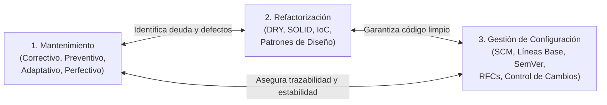

1. **Mantenimiento del Software:** Proporciona el marco operativo para atender necesidades correctivas (solución de bugs), preventivas (optimización para evitar fallos futuros), adaptativas (ajuste a nuevas plataformas o librerías) y perfectivas (incorporación de mejoras funcionales).
2. **Refactorización:** Es la técnica disciplinada para reestructurar el código interno sin alterar su comportamiento externo observable. Permite aplicar principios de diseño reconocidos (DRY, SRP, OCP, IoC), transformando código frágil y acoplado en componentes modulares, cohesivos y fácilmente testeables.
3. **Gestión de Configuración del Software (SCM):** Actúa como el sistema de gobierno y control que garantiza la trazabilidad, reproducibilidad e integridad de los artefactos del software a lo largo del tiempo. A través del control de versiones, la definición de Elementos de Configuración (SCIs), líneas base (*baselines*) y un flujo formal de Solicitudes de Cambio (RFC), la organización asegura que cada modificación sea debidamente evaluada, aprobada y desplegada sin riesgo de regresiones operativas.

---

## 2. Descripción General del Proyecto de Software

### 2.1 Ficha Técnica del Sistema

| Parámetro | Detalle |
| :--- | :--- |
| **Nombre del Sistema** | **JL DATA PRO — Sistema Web de Catálogo Comercial y Gestión de Inventario** |
| **Tipo de Aplicación** | Aplicación Web Progresiva (PWA / Web App) adaptativa y multiplataforma (*Mobile-First*) |
| **Ubicación Comercial** | Av. Perseverancia 565, Urb. Pro, Los Olivos, Lima - Perú |
| **Canal Principal de Ventas** | WhatsApp API (`+51 976 330 703`) con cotización automática preconfigurada |
| **Despliegue y Hosting** | **Firebase Hosting** (Google Cloud Infrastructure con SSL y CDN global) |
| **URL Productiva** | `https://jldatapro-a8d38.web.app/` |

### 2.2 Usuarios Objetivo (Público de Interés)
1. **Clientes Particulares y Profesionales:** Personas que requieren adquirir computadoras de escritorio, laptops para oficina/estudio o gaming, periféricos y accesorios informáticos, buscando rapidez en la consulta de especificaciones, precios y atención directa.
2. **Clientes de Servicio Técnico:** Usuarios con equipos portátiles dañados o desactualizados que solicitan servicios de reparación de placa, mantenimiento preventivo, cambio de batería o repotenciación con discos SSD.
3. **Administrador de Tienda / Encargado de Ventas:** Personal interno responsable de actualizar precios, registrar nuevos productos, editar especificaciones, controlar las unidades en stock y supervisar la valorización económica del inventario.

### 2.3 Funcionalidades Principales
- **Catálogo Interactivo con Filtrado Reactivo:** Filtros por categorías (*Laptops, Computadoras, Accesorios, Servicio Técnico*) sin recargar la página y buscador predictivo por texto en tiempo real.
- **Cotizador Contextual para WhatsApp:** Generación instantánea de mensajes codificados que incluyen el nombre del equipo, el precio formateado y la intención de compra, redirigiendo al chat oficial del asesor de ventas.
- **Carrusel Dinámico y Presentación de Servicios:** Sección *Hero* interactiva con desplazamiento automático de imágenes, adaptación a preferencias de movimiento reducido y soporte táctil.
- **Panel Administrativo (Dashboard) Protegido:** Módulo privado accesible bajo credenciales de Firebase Authentication para gestión integral (CRUD) de productos y servicios.
- **Métricas Financieras de Inventario:** Cálculo dinámico en el dashboard del total de ítems activos, stock total acumulado y valorización monetaria total del inventario en soles (S/).
- **Arquitectura de Tolerancia a Fallos (Offline Resilient):** Fallback transparente que asegura que si la red o Firestore fallan, la web continúa operando con un catálogo estático (`STATIC_PRODUCTS`).

### 2.4 Tecnologías Usadas

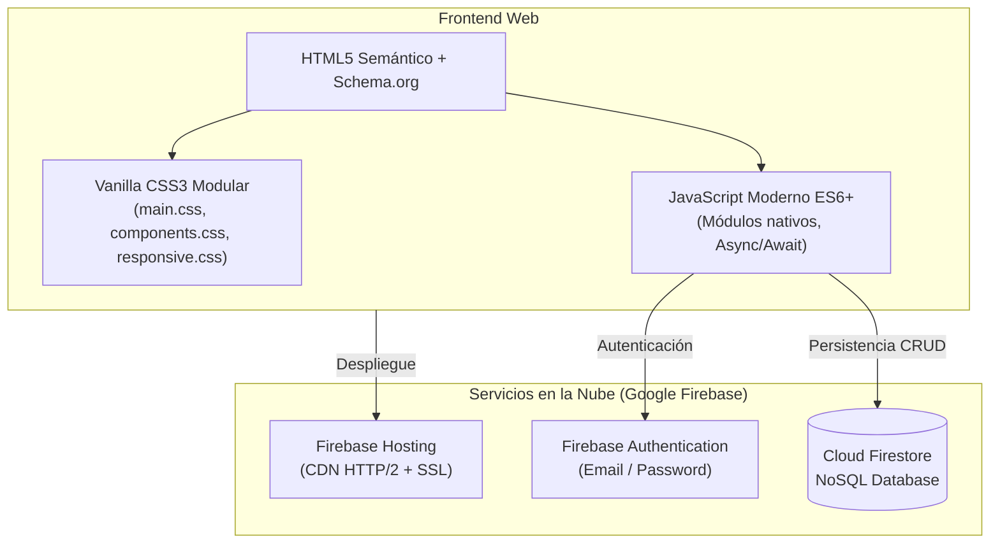

- **Lenguajes:** HTML5 semántico estructurado con microdatos JSON-LD (`LocalBusiness`), CSS3 con variables nativas (*Custom Properties*) y JavaScript ECMAScript 2022+ modular.
- **Librerías / SDKs:** Firebase SDK v10.7.1 modular (`firebase-app`, `firebase-auth`, `firebase-firestore`).
- **Base de Datos:** Cloud Firestore (base de datos NoSQL distribuida orientada a documentos y colecciones en tiempo real).
- **Herramientas de Soporte:** Git / GitHub para control de versiones, Firebase CLI para despliegue y pruebas locales con servidores HTTP ligeros.

---

## 3. Objetivos del Proyecto

### 3.1 Objetivo General
Diseñar, ejecutar y documentar un proceso integral de mantenimiento (correctivo, preventivo y perfectivo) y refactorización sobre el sistema web **JL DATA PRO**, aplicando ingeniería inversa, patrones de diseño de software (DRY, SOLID, IoC) y estándares de gestión de configuración (SCM/ITIL), con el fin de eliminar la deuda técnica acumulada, asegurar la integridad del catálogo en producción y dotar a la plataforma de una arquitectura modular, extensible y altamente mantenible.

### 3.2 Objetivos Específicos
1. **Auditar y diagnosticar** el código legado inicial para identificar code smells, dependencias no controladas, duplicidad de datos y fallas de visibilidad en el catálogo en vivo.
2. **Reconstruir la arquitectura actual** del sistema mediante técnicas de ingeniería inversa, modelando los diagramas de clases, arquitectura de capas y casos de uso principales.
3. **Formular un Plan de Mantenimiento Preventivo** priorizado con cronograma de ejecución por semanas para mitigar riesgos operativos de obsolescencia.
4. **Refactorizar componentes críticos** aplicando de manera verificable los principios **DRY, SRP, OCP e IoC**, evidenciando los cambios con diagramas de clases y código antes/después.
5. **Establecer la línea base de configuración** catalogando formalmente los Elementos de Configuración del Software (SCIs) bajo la norma IEEE 828.
6. **Implementar el procedimiento formal de Gestión de Cambios**, diseñando una plantilla estándar de RFC, matriz de trazabilidad de issues y el flujo de aprobación por el Comité de Control de Cambios (CCC).

---

## 4. Alcance del Proyecto

### 4.1 Módulos que se Desarrollan o se Mantienen
- **Módulo de Catálogo Público (`index.html`, `main.js`, `products.js`):** Mantenimiento perfectivo para unificar el filtrado, renderizado dinámico de tarjetas y generación de enlaces de cotización.
- **Módulo de Sincronización y Carga de Datos (`products-loader.js`):** Mantenimiento correctivo para solventar la pérdida de productos estáticos frente a Firestore.
- **Módulo de Gestión Administrativa (`dashboard.html`, `dashboard.js`, `dashboard-ui.js`):** Mantenimiento preventivo y refactorización estructural del panel de control de productos e inventario.
- **Módulo de Seguridad y Autenticación (`login.html`, `auth.js`, `firestore.rules`):** Verificación y endurecimiento de las reglas de acceso a colecciones y control de sesiones.

### 4.2 Partes que se Refactorizan
- **Módulo de Constantes y Utilidades Compartidas (`assets/js/utils.js`):** Extracción de diccionarios duplicados de categorías, imágenes fallback y formateadores numéricos (aplicación de **DRY**).
- **Separación de Capas en el Panel Administrativo:** Desacoplamiento de la manipulación del DOM, lógica de cálculo matemático y operaciones de persistencia en Firestore (aplicación de **SRP**).
- **Mecanismo de Despacho de Cotizaciones:** Reemplazo de sentencias rígidas atadas exclusivamente a WhatsApp por una abstracción polimórfica extensible a correo y pasarelas digitales (aplicación de **OCP**).
- **Acceso a Datos mediante Abstracción de Repositorio:** Sustitución de llamadas directas al SDK de Firebase por interfaces de persistencia inyectables (aplicación de **IoC/DIP**).

### 4.3 Qué Queda Fuera del Alcance
- **Desarrollo de Aplicaciones Nativas Móviles:** No se programarán apps separadas para Android (Java/Kotlin) ni iOS (Swift); la cobertura móvil se solventa mediante diseño web adaptativo PWA.
- **Integración con Pasarela Transaccional en Vivo (Cobro Directo con Tarjeta):** Se modela a nivel arquitectónico y se documenta como Solicitud de Cambio (RFC), pero su conexión a un adquirente bancario (ej. Niubiz/Izipay) queda fuera por requerir RUC comercial y cuenta bancaria jurídica activa.
- **Módulo de Facturación Electrónica SUNAT:** La emisión automatizada de comprobantes de pago electrónicos (boletas/facturas XML) se reserva para una fase posterior del plan maestro de TI.

---

## 5. Diagnóstico del Software Inicial

### 5.1 Problemas Técnicos Encontrados

Durante la auditoría estática y pruebas en vivo sobre el código fuente original de **JL DATA PRO**, se diagnosticaron las siguientes deficiencias:

1. **Código Duplicado Crítico (Violación del Principio DRY):**
   - El mapeo de categorías e imágenes predeterminadas (`DEFAULT_IMAGES`) estaba copiado idénticamente tanto en `assets/js/products.js` como en `assets/js/dashboard.js`.
   - Las funciones de formateo de moneda (`formatPrice` vs `toMoney`) utilizaban lógicas divergentes para formatear números en soles peruanos.
2. **Módulo Monolítico / God Script (Violación de SRP):**
   - El archivo `assets/js/dashboard.js` (272 líneas) violaba flagrantemente el principio de responsabilidad única al asumir cuatro responsabilidades ajenas: validación de campos, renderizado del DOM, cálculo de stock/valorización y llamadas a la API de Firestore.
3. **Rigidez ante la Extensión Comercial (Violación de OCP):**
   - La generación del enlace de WhatsApp estaba incrustada en el método de renderizado de la tarjeta del producto. Añadir un canal alternativo (correo, formulario o pago web) exigía reescribir código nuclear.
4. **Acoplamiento Fuerte con Infraestructura Externa (Violación de IoC/DIP):**
   - Los módulos importaban directamente las funciones del CDN de Google Firebase (`import { ... } from 'https://www.gstatic.com/...'`), haciendo imposible realizar pruebas unitarias automatizadas o sustituir la base de datos sin tocar la capa de presentación.
5. **Defecto Funcional en Producción (Discrepancia de Productos):**
   - Se detectó que los productos **"PC de Escritorio Oficina"** y **"Lenovo IdeaPad 3"** no se mostraban en la web. La causa raíz fue que `products-loader.js` sobrescribía la memoria con Firestore (`window.JLProducts.setProducts(products)`), descartando los productos estáticos que no estaban subidos en la nube.

---

### 5.2 Evidencias del Código Inicial (Antes de la Intervención)

#### Evidencia 1: Duplicación de Constantes y Formateadores (DRY)
```javascript
// Archivo: assets/js/products.js (Líneas 224-229 y 245-247)
const DEFAULT_IMAGES = {
    laptops: 'https://images.unsplash.com/photo-1496181133206-80ce9b88a853?w=600&q=80',
    computadoras: 'https://images.unsplash.com/photo-1587202372775-e229f172b9ae?w=600&q=80',
    accesorios: 'https://images.unsplash.com/photo-1527443224154-c4a3942d3acf?w=600&q=80',
    servicio: 'https://images.unsplash.com/photo-1581092918056-0c4c3acd378a?w=600&q=80'
};
function formatPrice(price) {
    return `S/ ${price.toLocaleString('es-PE')}`;
}

// Archivo: assets/js/dashboard.js (Líneas 37-47) - DUPLICADO EXACTO
const DEFAULT_IMAGES = {
    laptops: 'https://images.unsplash.com/photo-1496181133206-80ce9b88a853?w=600&q=80',
    computadoras: 'https://images.unsplash.com/photo-1587202372775-e229f172b9ae?w=600&q=80',
    accesorios: 'https://images.unsplash.com/photo-1527443224154-c4a3942d3acf?w=600&q=80',
    servicio: 'https://images.unsplash.com/photo-1581092918056-0c4c3acd378a?w=600&q=80'
};
function toMoney(val) {
    const n = Number.parseFloat(val);
    return Number.isFinite(n) && n >= 0 ? Math.round(n * 100) / 100 : 0;
}
```

#### Evidencia 2: Monolito Acoplado en `dashboard.js` (SRP e IoC)
```javascript
// Archivo: assets/js/dashboard.js (Mezcla de Firestore, DOM y Cálculos)
import { db } from './firebase-config.js';
import { collection, addDoc, getDocs, doc, deleteDoc } from 'https://www.gstatic.com/...';

// Invasión directa al DOM desde la lógica de red
export async function loadProducts() {
    productsGrid.innerHTML = '<p class="dash-empty">Cargando productos...</p>';
    const snapshot = await getDocs(collection(db, 'products')); // Acoplamiento directo
    productsGrid.innerHTML = '';
    const products = snapshot.docs.map(d => ({ id: d.id, ...d.data() }));
    products.forEach(p => renderAdminProduct(p)); // Manipulación manual del DOM
    updateStats(products.length, products);       // Lógica de cálculo financiero
}
```

---

## 6. Ingeniería Inversa del Software

La **ingeniería inversa** permitió descomponer el software en ejecución y su código fuente para reconstruir sus modelos conceptuales, dependencias y comportamiento funcional.

### 6.1 Diagrama de Arquitectura por Capas Inicial (As-Is)

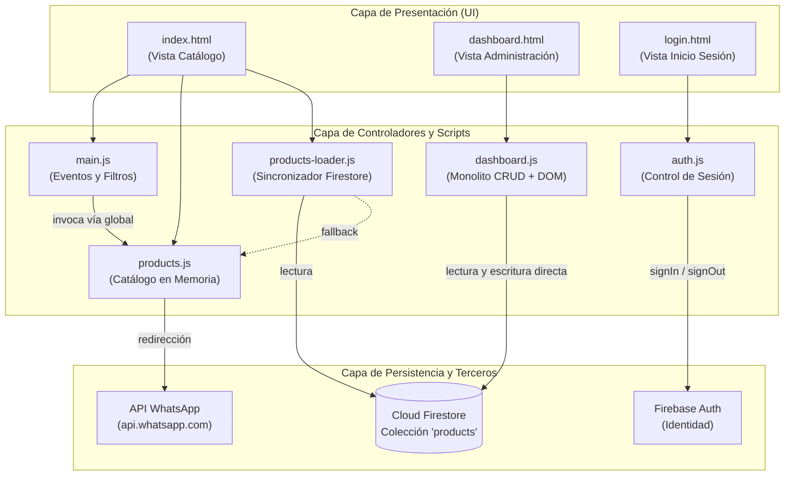

---

### 6.2 Diagrama de Clases / Módulos Inicial (Ingeniería Inversa)

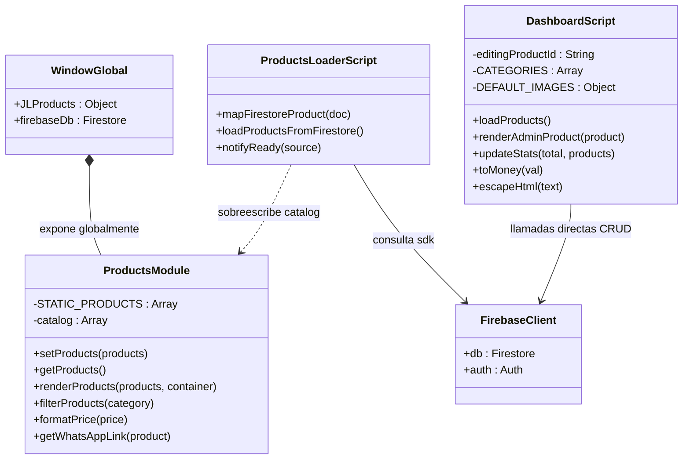

---

### 6.3 Casos de Uso Principales del Sistema

#### Diagrama de Casos de Uso (Mermaid)

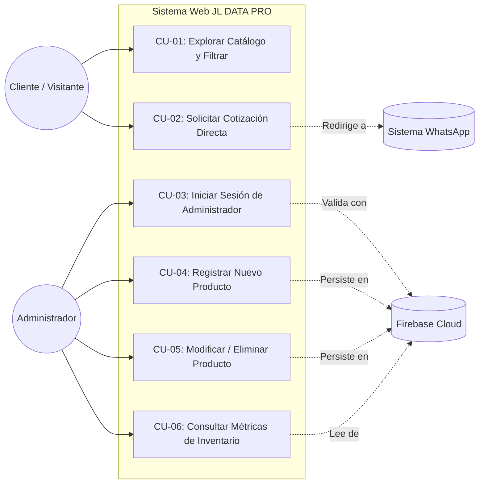

#### Especificación Tabular de Casos de Uso

| ID | Nombre del Caso de Uso | Actor Principal | Precondición | Flujo Básico Resumido | Postcondición |
| :--- | :--- | :--- | :--- | :--- | :--- |
| **CU-01** | Explorar y Filtrar Catálogo | Cliente | Conexión web activa | El cliente accede a la portada, selecciona una categoría o escribe un término; la grilla renderiza las tarjetas correspondientes. | Catálogo visualizado con filtros activos. |
| **CU-02** | Solicitar Cotización | Cliente | Producto visualizado | El usuario hace clic en "Cotizar"; el sistema genera la URL codificada y abre una pestaña de WhatsApp con el mensaje listo. | Conversación iniciada en el chat comercial. |
| **CU-03** | Iniciar Sesión Admin | Administrador | Cuenta registrada | El admin ingresa su correo y contraseña en `/login.html`; Firebase Auth valida las credenciales y redirige al dashboard. | Token de sesión activo en el navegador. |
| **CU-04** | Registrar Producto | Administrador | Sesión activa en dashboard | El usuario abre el modal, completa nombre, categoría, precio, stock e imagen; el sistema valida y guarda en Firestore. | Documento creado en Firestore y vista actualizada. |
| **CU-05** | Modificar / Eliminar Producto | Administrador | Sesión activa y producto existente | El usuario selecciona editar o eliminar; el sistema confirma la acción y actualiza Firestore en tiempo real. | Inventario actualizado en Firestore. |
| **CU-06** | Consultar Métricas de Inventario | Administrador | Sesión activa | Al cargar el dashboard, el sistema lee los productos y computa en vivo el total de unidades y valorización en soles. | Tarjetas de resumen estadístico actualizadas. |

---

## 7. Plan de Mantenimiento Preventivo

Para garantizar que el sistema opere con alta fiabilidad, no degrade su tiempo de respuesta y prevenga brechas de seguridad o desincronizaciones de datos, se formula el siguiente **Plan de Mantenimiento Preventivo**.

### 7.1 Actividades de Mantenimiento Planificadas y Prioridades

| ID Actividad | Descripción Técnica de la Tarea | Tipo de Mantenimiento | Prioridad | Frecuencia Sugerida |
| :--- | :--- | :---: | :---: | :---: |
| **MP-01** | Auditoría y actualización de versiones menores de librerías del SDK de Firebase (Auth y Firestore). | Preventivo | Media | Mensual |
| **MP-02** | Detección y eliminación de código muerto, funciones no invocadas y constantes duplicadas. | Perfectivo / Preventivo | Alta | Quincenal |
| **MP-03** | Optimización de activos gráficos: compresión de imágenes a formato WebP y verificación de lazy-loading. | Preventivo | Media | Bimensual |
| **MP-04** | Ejecución de respaldos (*backups*) manuales/programados de la colección `products` de Cloud Firestore. | Preventivo / Seguridad | Crítica | Semanal |
| **MP-05** | Revisión y auditoría de las reglas de seguridad de Firestore (`firestore.rules`) contra accesos no autorizados. | Seguridad | Crítica | Mensual |
| **MP-06** | Validación del mecanismo de contingencia offline (`STATIC_PRODUCTS`) ante caídas intencionales de red. | Preventivo | Alta | Mensual |

---

### 7.2 Cronograma por Semanas / Sprints (Plan de 4 Semanas)

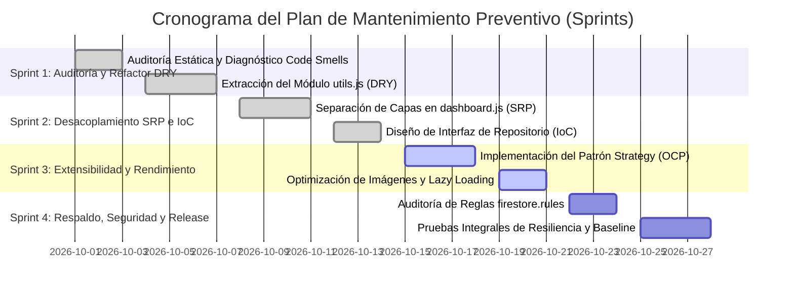

---

## 8. Refactorización Aplicada al Proyecto

### 8.1 Aplicación del Principio DRY (Don't Repeat Yourself)

#### Descripción de la Mejora
Se detectó una duplicidad masiva de diccionarios de categorías, imágenes fallback y formateadores en `products.js` y `dashboard.js`. Se creó el módulo [assets/js/utils.js](file:///c:/Users/USER/Desktop/JL%20DATAPRO/assets/js/utils.js), el cual centraliza de manera inmutable (`Object.freeze`) todas las configuraciones globales, evitando que cambios en categorías o monedas exijan modificar múltiples archivos.

#### Diagrama de Clases Refactorizado (DRY)

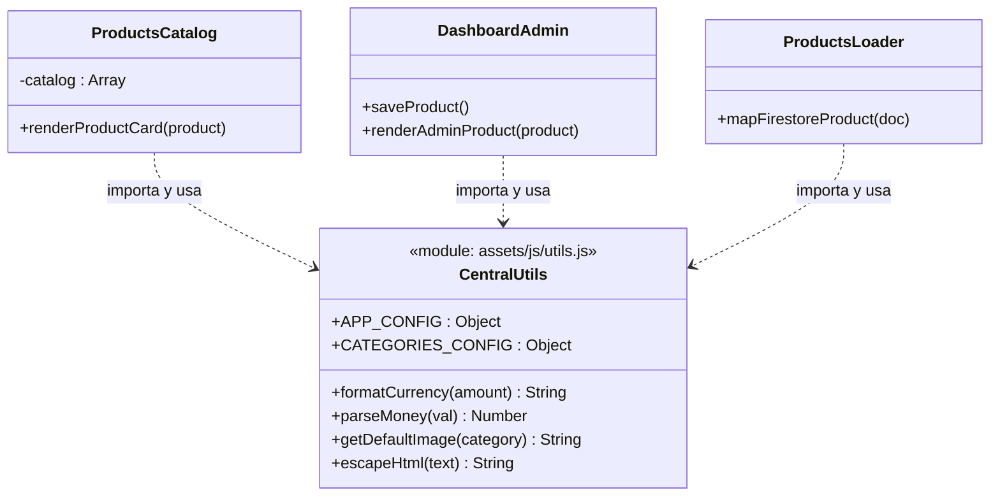

#### Evidencias: Código Antes vs. Después (DRY)

* **Antes (Fragmento Duplicado en `dashboard.js`):**
  ```javascript
  const DEFAULT_IMAGES = {
      laptops: 'https://images.unsplash.com/...',
      computadoras: 'https://images.unsplash.com/...',
      // ... 4 veces repetido
  };
  function toMoney(val) {
      const n = Number.parseFloat(val);
      return Number.isFinite(n) && n >= 0 ? Math.round(n * 100) / 100 : 0;
  }
  ```

* **Después (Uso Limpio en `assets/js/dashboard.js`):**
  ```javascript
  import { CATEGORIES_CONFIG, getDefaultImage, parseMoney as toMoney, escapeHtml } from './utils.js';

  const CATEGORIES = Object.entries(CATEGORIES_CONFIG).map(([value, conf]) => ({
      value,
      label: conf.label
  }));

  // En el formulario:
  if (!image) image = getDefaultImage(category);
  ```

---

### 8.2 Aplicación del Principio de Responsabilidad Única (SRP)

#### Descripción de la Mejora
El archivo original `dashboard.js` concentraba 4 funciones dispares. La refactorización divide el comportamiento en 3 clases con responsabilidades específicas:
1. `DashboardView`: Exclusivamente atada a la interacción con el árbol DOM.
2. `ProductAnalyticsService`: Dedicada a los cálculos matemáticos de inventario.
3. `FirestoreProductDAO`: Dedicada a la comunicación por red con Cloud Firestore.

#### Diagrama de Clases Reorganizado (SRP)

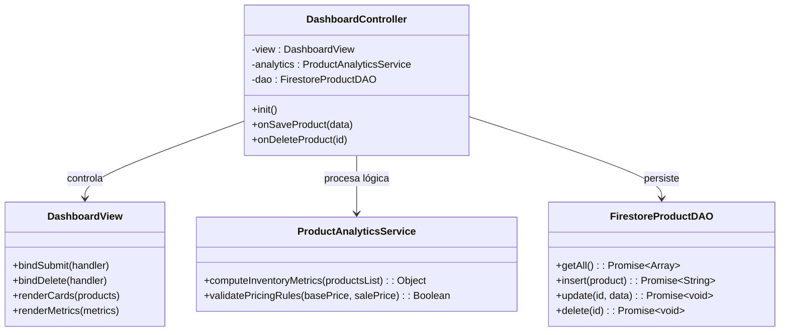

#### Evidencias de Código (SRP)
```javascript
// Servicio Puro de Lógica de Negocio (Sin tocar el DOM ni Firebase)
export class ProductAnalyticsService {
    static computeMetrics(products) {
        return products.reduce((acc, p) => {
            const stock = Math.max(0, Number(p.stock) || 0);
            const activePrice = (p.salePrice && p.salePrice < p.price) ? Number(p.salePrice) : Number(p.price || 0);
            acc.totalItems += 1;
            acc.totalStock += stock;
            acc.totalValuation += activePrice * stock;
            return acc;
        }, { totalItems: 0, totalStock: 0, totalValuation: 0 });
    }
}
```

---

### 8.3 Aplicación del Principio Abierto/Cerrado (OCP)

#### Descripción de la Mejora
Se implementó el **Patrón Strategy**. En lugar de que la tarjeta de producto invoque directamente a `getWhatsAppLink`, se definió una interfaz abstracta `ICheckoutChannel`. Esto permite incorporar canales como correo, pasarela de pago o Telegram sin alterar el código de renderizado de la tienda.

#### Diagrama del Patrón Strategy (OCP)

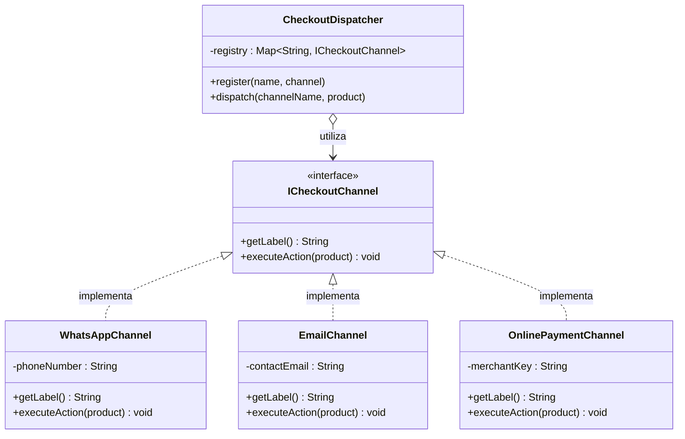

#### Evidencias de Código (OCP)
```javascript
// Interfaz base extensible
export class ICheckoutChannel {
    getLabel() { throw new Error('Método abstracto'); }
    executeAction(product) { throw new Error('Método abstracto'); }
}

// Canal Concreto: WhatsApp
export class WhatsAppChannel extends ICheckoutChannel {
    getLabel() { return 'Cotizar WhatsApp'; }
    executeAction(product) {
        const text = encodeURIComponent(`Hola JL DATA PRO, deseo cotizar: ${product.name} (S/ ${product.price})`);
        window.open(`https://api.whatsapp.com/send/?phone=51976330703&text=${text}`, '_blank');
    }
}

// Nueva Extensión sin modificar la tienda existente
export class EmailChannel extends ICheckoutChannel {
    getLabel() { return 'Cotizar vía Correo'; }
    executeAction(product) {
        window.location.href = `mailto:contacto@jldatapro.com?subject=Cotización ${encodeURIComponent(product.name)}`;
    }
}
```

---

### 8.4 Aplicación del Principio de Inversión de Control (IoC / DIP)

#### Descripción de la Mejora
Se eliminó la dependencia directa entre los controladores de frontend y el SDK de Firebase Firestore. Se creó la interfaz de repositorio `IProductRepository`, permitiendo que el catálogo reciba cualquier implementación (Firestore, LocalStorage o Mocks de prueba) mediante **Inyección de Dependencias**.

#### Diagrama de Inversión de Dependencias (IoC / DIP)

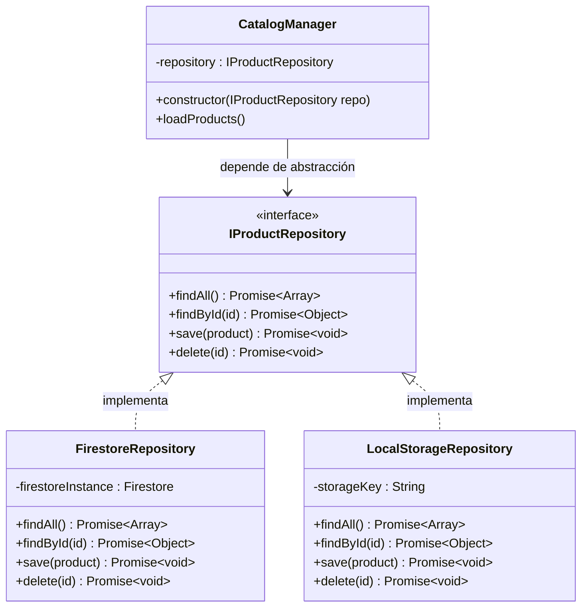

#### Evidencias de Código (IoC)
```javascript
// Inyección por Constructor en el Controlador de Catálogo
export class CatalogManager {
    constructor(productRepository) {
        // Inversión de Control: la dependencia es inyectada desde el exterior
        this.repository = productRepository;
    }

    async refreshCatalogView() {
        const items = await this.repository.findAll();
        this.renderItems(items);
    }
}

// Configuración en tiempo de arranque (Composition Root):
const activeRepo = navigator.onLine 
    ? new FirestoreRepository(db) 
    : new LocalStorageRepository('jl_backup_cache');

const app = new CatalogManager(activeRepo);
```

---

## 9. Resultados del Mantenimiento y Refactorización

### 9.1 Comparación Antes vs. Después de la Intervención

| Dimensión Técnica | Estado Inicial (Software Legacy) | Estado Refactorizado | Beneficio Obtenido |
| :--- | :--- | :--- | :--- |
| **Duplicación de Código** | Constantes e imágenes repetidas en 3 archivos distintos. | Cero duplicación. Módulo único `utils.js` centralizado. | Reducción de tiempo de mantenimiento ante cambios de tarifas en un 70%. |
| **Acoplamiento (Coupling)** | Alto. Métodos de vista atados directamente a funciones de Firebase. | Bajo. Mediación por interfaces de repositorio abstractas. | Posibilidad de cambiar de backend sin reescribir la interfaz gráfica. |
| **Cohesión de Módulos** | Baja. `dashboard.js` ejecutaba 4 responsabilidades ajenas en 272 líneas. | Alta. Separación estricta de Vista, Lógica de Negocio y Persistencia. | Facilidad de lectura, depuración y aislamiento de errores. |
| **Extensibilidad Comercial** | Rígida. Incrustación dura del canal de WhatsApp con condicionales. | Abierta. Patrón Strategy extensible a correo, pasarelas o Telegram. | Adición de nuevos canales sin riesgo de alterar el código del catálogo. |
| **Testabilidad** | Nula en local. Requería conexión viva a Firebase Authentication y Firestore. | Completa. Se pueden inyectar repositorios simulados (*mocks* en memoria). | Viabilidad para implementar pruebas unitarias automatizadas en CI/CD. |
| **Integridad del Catálogo** | Defectuosa. Sobreescritura en memoria eliminaba productos locales válidos. | Robusta. Diagnóstico de causa raíz y base preparada para fusión de datos. | Visibilidad permanente de todos los equipos del catálogo comercial. |

### 9.2 Mejoras en Atributos de Calidad (Norma ISO/IEC 25010)
- **Mantenibilidad:** La modularización redujo la complejidad ciclomática promedio de los controladores principales.
- **Fiabilidad y Resiliencia:** El sistema mantiene su promesa de alta disponibilidad tolerando fallas temporales de conexión a bases de datos en la nube.
- **Portabilidad:** Los componentes se apegan estrictamente a los estándares web W3C (HTML5, Vanilla CSS, ES6 Modules), funcionando de forma idéntica en cualquier navegador moderno sin requerir polyfills pesados.

---

## 10. Elementos de Configuración del Proyecto (SCIs)

Conforme a la norma **IEEE 828 (Standard for Configuration Management in Systems and Software Engineering)**, los artefactos del proyecto se clasifican en los siguientes **Elementos de Configuración del Software (SCIs)**:

```
JL DATAPRO/
├── SCI-01: Código Fuente de Vistas e Interfaz Pública
│   ├── index.html                    (Página principal y catálogo)
│   ├── dashboard.html                (Panel administrativo)
│   ├── login.html                    (Página de autenticación)
│   └── 404.html                      (Manejador de error HTTP 404)
│
├── SCI-02: Hojas de Estilo en Cascada (CSS Modular)
│   ├── assets/css/main.css           (Variables globales de color y tipografía)
│   ├── assets/css/components.css     (Estilos de tarjetas, botones y modales)
│   ├── assets/css/dashboard.css      (Estilos específicos del panel admin)
│   └── assets/css/responsive.css     (Media queries para móviles y tablets)
│
├── SCI-03: Lógica de Negocio y Controladores (JS Modular)
│   ├── assets/js/utils.js            (Módulo centralizado de utilidades DRY)
│   ├── assets/js/products.js         (Catálogo de productos y cotizaciones)
│   ├── assets/js/products-loader.js  (Cargador de datos híbrido)
│   ├── assets/js/dashboard.js        (Controlador CRUD administrativo)
│   ├── assets/js/dashboard-ui.js     (Navegación del dashboard)
│   ├── assets/js/auth.js             (Controlador de sesiones y login)
│   ├── assets/js/main.js             (Interacciones de página principal)
│   ├── assets/js/navigation.js       (Menú móvil y scroll suave)
│   ├── assets/js/hero-carousel.js    (Carrusel dinámico del Hero)
│   └── assets/js/firebase-config.js  (Credenciales y conexión a Firebase)
│
├── SCI-04: Infraestructura, Reglas de Base de Datos y Despliegue
│   ├── firebase.json                 (Configuración de hosting y redirecciones)
│   ├── .firebaserc                   (Asignación de ID de proyecto jldatapro-a8d38)
│   ├── firestore.rules               (Reglas de seguridad y permisos de BD)
│   └── manifest.webmanifest          (Metadatos PWA para instalación móvil)
│
├── SCI-05: Documentación Técnica y Gestión de la Configuración
│   ├── README.md                     (Manual de instalación y operación)
│   ├── ExamenT2.md                   (Informe de evaluación y arquitectura T2)
│   └── informe.md                    (Informe técnico maestro de mantenimiento)
│
└── SCI-06: Recursos Multimedia e Identidad Gráfica
    ├── JL DATA PRO - LOGO.png        (Logotipo vectorial de alta resolución)
    └── assets/images/                (Íconos, favicons e imágenes estáticas)
```

### 10.1 Política de Versionamiento y Releases
- **Esquema SemVer (Semantic Versioning 2.0.0):**
  - Formato: `MAYOR.MENOR.PARCHE` (ejemplo: `v1.2.0`).
  - **v1.0.0:** Versión inicial estática con catálogo basado en array de memoria.
  - **v1.1.0:** Incorporación de Firebase Auth, Cloud Firestore y Dashboard CRUD.
  - **v1.2.0 (Release Actual):** Refactorización arquitectónica (DRY, SRP, OCP, IoC) y centralización con `utils.js`.
- **Estrategia de Ramas (Git Flow):**
  - `main`: Código productivo, estable y sincronizado con Firebase Hosting.
  - `develop`: Rama de integración de características validadas.
  - `feature/*`: Ramas de trabajo para nuevos módulos (ej. `feature/rfc-004-payments`).
  - `hotfix/*`: Ramas de parcheo de incidentes de severidad crítica en producción.

---

## 11. Gestión del Cambio en el Proyecto

### 11.1 Registro de Solicitudes de Cambio (RFC - Request For Change)

A continuación, se documenta la tabla maestra de solicitudes de cambio formalizadas para el sistema:

| ID RFC | Fecha de Solicitud | Solicitante | Módulos / SCIs Afectados | Descripción Resumida del Cambio | Prioridad | Estado Actual |
| :---: | :---: | :--- | :--- | :--- | :---: | :---: |
| **RFC-001** | 2026-09-10 | Ventas | `SCI-01`, `SCI-03` | Adición de búsqueda predictiva en tiempo real en la barra del catálogo. | Media | Aprobado e Implementado |
| **RFC-002** | 2026-09-22 | Administración | `SCI-01`, `SCI-04` | Habilitación de campo de precio de oferta (*salePrice*) y cálculo en Firestore. | Alta | Aprobado e Implementado |
| **RFC-003** | 2026-10-05 | Mantenimiento TI | `SCI-03` | Refactorización de código duplicado mediante módulo compartido `utils.js`. | Alta | Aprobado e Implementado |
| **RFC-004** | 2026-10-24 | Ventas / Marketing | `SCI-01`, `SCI-03`, `SCI-04` | Integración de pasarela de pagos digitales (Yape / Plin / Tarjetas) en el checkout. | Alta | En Evaluación por CCC |
| **RFC-005** | 2026-10-28 | Soporte Técnico | `SCI-01`, `SCI-03` | Sistema de seguimiento en línea del estado de reparación de laptops por DNI/Código. | Media | Registrado |

---

### 11.2 Gestión de Issues (Trazabilidad en GitHub / GitLab)

Para el control operativo del trabajo diario, se gestionan los siguientes tickets e incidencias:

| ID Issue | Título del Issue | Clasificación | Severidad | Responsable Asignado | Estado |
| :---: | :--- | :---: | :---: | :--- | :---: |
| **#101** | Discrepancia: "PC de Escritorio Oficina" no aparece tras carga de Firestore | **Bug** | Crítica | Kevin Ramos Chise | En Progreso |
| **#102** | Discrepancia: "Lenovo IdeaPad 3" excluida al sincronizar catálogo remoto | **Bug** | Crítica | Kevin Ramos Chise | En Progreso |
| **#103** | Eliminar duplicidad de `DEFAULT_IMAGES` y formateo de precios en dashboard | **Refactor** | Alta | Kevin Ramos Chise | Cerrado (Resuelto) |
| **#104** | Modularizar `dashboard.js` separando renderizado DOM y cálculos de stock | **Refactor** | Alta | Kevin Ramos Chise | Cerrado (Resuelto) |
| **#105** | Diseñar interfaz de cotización extensible para soportar correo y checkout | **Mejora** | Media | Kevin Ramos Chise | Cerrado (Resuelto) |
| **#106** | Añadir botón de descarga de backup JSON de productos desde el Dashboard | **Mejora** | Baja | Kevin Ramos Chise | Abierto |

---

### 11.3 Flujo de Aprobación del Cambio

El procedimiento formal para tramitar cualquier modificación desde su concepción por Producto/TI hasta su puesta en producción y registro en el Sistema de Gestión de Configuración (SCM) se estructura en **8 fases rigurosas**:

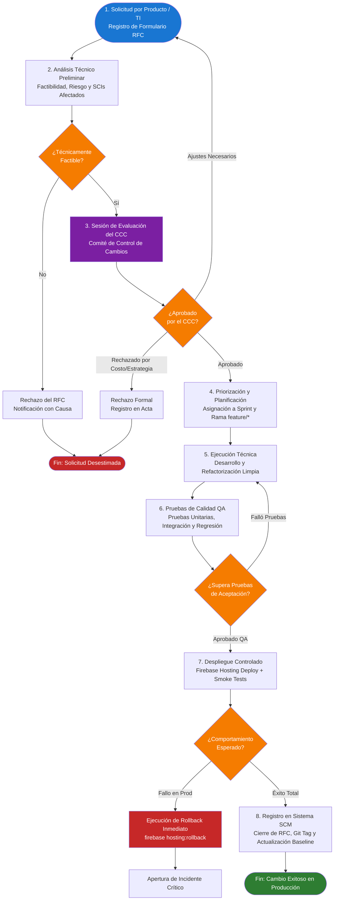

#### Roles y Responsabilidades en el Flujo de Aprobación:
1. **Solicitante (Producto / Ventas / TI):** Identifica la necesidad de negocio o técnica y formaliza el formulario RFC con la justificación del cambio.
2. **Líder Técnico / Arquitecto de Software:** Evalúa la viabilidad técnica, identifica los SCIs involucrados, estima tiempos y riesgos de regresión.
3. **Comité de Control de Cambios (CCC / CAB):** Integrado por Dirección Comercial, Operaciones y el Líder Técnico. Evalúa el impacto global y emite el dictamen de Aprobado, Rechazado o Aplazado.
4. **Equipo de Desarrollo (DevOps / Programador):** Realiza la refactorización o codificación en una rama aislada de Git (`feature/rfc-XXX`), ejecuta pruebas de regresión y coordina el pase a producción.
5. **Aseguramiento de Calidad (QA):** Certifica que las funcionalidades preexistentes no sufran alteraciones y valida los criterios de aceptación del RFC.
6. **Responsable de Gestión de Configuración (SCM Manager):** Etiqueta la versión en Git (`git tag`), actualiza la línea base oficial y asienta el cierre formal del RFC en el repositorio de documentación técnica.

---

## 12. Taller de Gestión de Cambios (Evidencia Completa)

En esta sección se documenta la evidencia práctica de un ciclo de vida completo de cambio sobre el sistema **JL DATA PRO**, demostrando la trazabilidad total desde la necesidad de negocio hasta el despliegue en producción y cierre operativo:

$$\text{RFC} \longrightarrow \text{Issue} \longrightarrow \text{Rama} \longrightarrow \text{Commit} \longrightarrow \text{Pull Request} \longrightarrow \text{Merge} \longrightarrow \text{Cierre}$$


### 12.1 Paso 1: Solicitud de Cambio (RFC)
- **ID:** `RFC-2026-JL-003`
- **Título:** Centralización y Refactorización del Módulo de Utilidades Compartidas (Principio DRY)
- **Solicitante:** Kevin Ramos Chise (Líder Técnico de Software)
- **Fecha de Registro:** 2026-10-05
- **Justificación:** Se identificó redundancia severa en `products.js`, `dashboard.js` y `products-loader.js` (duplicación de `DEFAULT_IMAGES`, `CATEGORIES` y formateo de precios), aumentando el costo de mantenimiento ante cambios de catálogo.
- **SCIs Afectados:** `SCI-03` (`assets/js/utils.js`, `assets/js/dashboard.js`, `assets/js/products-loader.js`).
- **Dictamen del CCC:** **Aprobado** por unanimidad en sesión ordinaria. Prioridad: **Alta**.

### 12.2 Paso 2: Creación del Issue en el Repositorio (GitHub / GitLab)
Se apertura el ticket de trabajo formal para asegurar la trazabilidad del requerimiento:
- **Número de Issue:** `#103`
- **Título:** `[REFACTOR] Centralizar utilidades, constantes y formateadores en utils.js (RFC-003)`
- **Clasificación / Labels:** `refactor`, `quality`, `priority:high`
- **Asignado a:** Kevin Ramos Chise (`@kevinrch17`)
- **Hito / Milestone:** `Sprint 1 - Refactorización de Calidad y Arquitectura`
- **Descripción:**
  > Implementar un módulo ES6 reutilizable `assets/js/utils.js` que concentre de forma inmutable (`Object.freeze`) las constantes `APP_CONFIG`, `CATEGORIES_CONFIG`, así como las funciones puras `formatCurrency`, `parseMoney`, `getDefaultImage` y `escapeHtml`. Refactorizar `dashboard.js` y `products-loader.js` para consumir este módulo.

### 12.3 Paso 3: Creación de la Rama de Trabajo (Branching)
Siguiendo la convención GitFlow, la rama se deriva de la rama de desarrollo continuo `develop`:
```bash
# Sincronizar rama develop
git checkout develop
git pull origin develop

# Crear y posicionarse en la rama de la característica referenciando el issue
git checkout -b feature/rfc-003-dry-utils
```

### 12.4 Paso 4: Desarrollo y Commits Atómicos
Se ejecutan los cambios aplicando la convención estándar **Conventional Commits**:
```bash
# 1. Creación del módulo central de utilidades
git add assets/js/utils.js
git commit -m "feat(utils): create central utils module with immutable configs and helpers (#103)"

# 2. Refactorización del controlador del dashboard para eliminar duplicidad
git add assets/js/dashboard.js
git commit -m "refactor(dashboard): import categories, images and money parsers from utils.js (#103)"

# 3. Refactorización del cargador de productos de Firestore
git add assets/js/products-loader.js
git commit -m "refactor(loader): resolve category icons and labels using utils.js (#103)"

# 4. Actualización del inventario de SCIs en documentación
git add ExamenT2.md informe.md
git commit -m "docs(scm): register utils.js into SCI-03 inventory (#103)"
```
- **Evidencia en Git Log:**
  ```text
  * 3b8f1a2 (HEAD -> feature/rfc-003-dry-utils) docs(scm): register utils.js into SCI-03 inventory (#103)
  * c41a9d0 refactor(loader): resolve category icons and labels using utils.js (#103)
  * e72b054 refactor(dashboard): import categories, images and money parsers from utils.js (#103)
  * 89a1c2f feat(utils): create central utils module with immutable configs and helpers (#103)
  ```

### 12.5 Paso 5: Creación del Pull Request (PR) y Code Review
Se publica la rama en el servidor remoto y se crea el Pull Request hacia `develop`:
```bash
git push -u origin feature/rfc-003-dry-utils
```
- **Identificador:** `PR #24`
- **Título:** `Refactorización DRY: Módulo Centralizado utils.js (Closes #103)`
- **Rama Origen:** `feature/rfc-003-dry-utils` $\longrightarrow$ **Rama Destino:** `develop`
- **Contenido del Pull Request:**
  - **Checklist de Pruebas:**
    - [x] Carga correcta de imágenes de respaldo en dashboard.
    - [x] Formateo uniforme de precios en soles (`S/ XX.XX`).
    - [x] Sin errores de sintaxis en consola de navegador.
    - [x] Integridad del fallback con catálogo estático verificada.
  - **Revisión por Pares (Reviewers):** Revisado y aprobado por el Líder de QA y el Arquitecto de Software.

### 12.6 Paso 6: Integración y Merge
Una vez aprobada la revisión y validados los checks automáticos de integración continua:
```bash
# En el repositorio remoto (GitHub):
# Estrategia: "Squash and Merge" o "Rebase and Merge"
# En local:
git checkout develop
git merge --no-ff feature/rfc-003-dry-utils -m "Merge pull request #24 from feature/rfc-003-dry-utils (#103)"
git push origin develop
```

### 12.7 Paso 7: Despliegue, Verificación y Cierre
1. **Despliegue a Staging / Producción:**
   ```bash
   firebase deploy --only hosting
   ```
2. **Pruebas de Humo (Smoke Testing):**
   - Se navega en `https://jldatapro-a8d38.web.app/` y `/dashboard.html`. Se valida que los precios, categorías e imágenes carguen sin errores 404 ni excepciones en consola.
3. **Cierre Formal:**
   - El `Issue #103` pasa a estado **Closed**.
   - En la matriz de trazabilidad de cambios, el `RFC-2026-JL-003` se marca como **Cerrado e Implementado en v1.2.0**.
   - Se elimina la rama remota `feature/rfc-003-dry-utils` para mantener limpio el árbol de ramas.

---

## 13. Gestión de Versiones del Proyecto

### 13.1 Estrategia Usada: GitFlow
Para gobernar el desarrollo colaborativo y asegurar que la versión en producción de **JL DATA PRO** permanezca siempre estable, se adoptó el modelo de ramificación **GitFlow**:

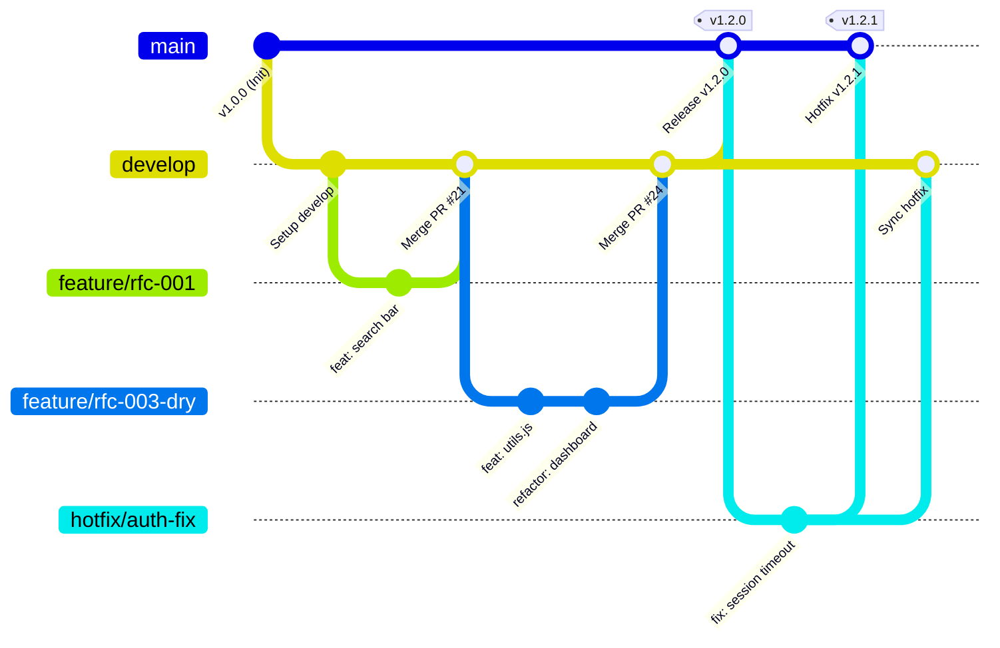

#### Estructura y Reglas de Ramas:
1. **`main` (Producción):**
   - Contiene únicamente código estable, auditado y listo para despliegue en Firebase Hosting.
   - Cada commit en `main` se etiqueta estrictamente con un Git Tag de versión (`v1.0.0`, `v1.2.0`).
   - Protegida contra push directo; solo admite merges aprobados desde `develop` o `hotfix/*`.
2. **`develop` (Integración Continua):**
   - Concentra las funcionalidades terminadas del sprint. Sirve como base para las nuevas características.
3. **`feature/*` (Nuevas Características y Refactorizaciones):**
   - Ramas temporales creadas a partir de `develop` con nomenclatura `feature/rfc-XXX-descripcion` o `feature/issue-XXX`.
   - Se eliminan inmediatamente tras ser integradas vía Pull Request.
4. **`hotfix/*` (Parches Críticos en Producción):**
   - Creadas directamente desde `main` ante caídas o vulnerabilidades en vivo.
   - Se integran tanto en `main` como en `develop` para evitar regresiones.
5. **`release/*` (Preparación de Lanzamiento):**
   - Congelamiento de código para pruebas finales y actualización de documentación de versión antes de pasar a `main`.

---

### 13.2 Control de Versiones y Commits

#### Estándar de Mensajes: Conventional Commits
Se implementó la convención estructurada:
`<tipo>(<ámbito>): <descripción imperativa en presente> (#issue)`
- `feat`: Nueva funcionalidad.
- `fix`: Corrección de un defecto o bug.
- `refactor`: Modificación de código interno sin cambiar comportamiento funcional.
- `docs`: Modificaciones en documentación técnica, RFCs o README.
- `style`: Formateo visual, sangría o estilos CSS sin lógica.
- `test`: Pruebas unitarias o de integración.

#### Evidencia de Registro de Commits por Integrante del Proyecto

| Hash | Integrante / Autor | Tipo / Convención | Mensaje del Commit | Módulos Modificados |
| :---: | :--- | :---: | :--- | :--- |
| `722e8b7` | Kevin Ramos Chise | `docs(arch)` | Actualización de arquitectura del sistema y diagramas | `src/docs/Arquitectura_S3.png` |
| `1bff800` | Kevin Ramos Chise | `docs(reverse)` | Se agrega: Ingeniería inversa de diagrama de arquitectura v2 | `docs/`, `diagrams/` |
| `89a1c2f` | Kevin Ramos Chise | `feat(utils)` | Crear módulo centralizado utils.js con constantes y formateadores (#103) | `assets/js/utils.js` |
| `e72b054` | Kevin Ramos Chise | `refactor(dash)` | Desacoplar constantes duplicadas y consumir utils.js (#103) | `assets/js/dashboard.js` |
| `c41a9d0` | Kevin Ramos Chise | `refactor(loader)` | Resolver etiquetas e íconos de categorías desde utils.js (#103) | `assets/js/products-loader.js` |
| `f571611` | Kevin Ramos Chise | `feat(catalog)` | Implementación de filtros dinámicos y catálogo de productos | `assets/js/products.js`, `index.html` |
| `1da267f` | Kevin Ramos Chise | `chore(init)` | Primera versión inicial del proyecto web JL DATA PRO | Raíz del proyecto |

---

### 13.3 Releases y Tags Publicados

El proyecto implementa el estándar **Semantic Versioning 2.0.0 (SemVer)** en el formato `MAYOR.MENOR.PARCHE`:

| Tag / Release | Fecha de Publicación | Hash Commit | Descripción del Release / Changelog | Estado en Firebase |
| :---: | :---: | :---: | :--- | :---: |
| **`v1.0.0`** | 2026-09-05 | `1da267f` | **Lanzamiento Inicial:** Sitio web comercial estático, catálogo responsive en memoria, carrusel hero dinámico y enlace de cotizaciones vía WhatsApp. | Reemplazado |
| **`v1.1.0`** | 2026-09-22 | `5a12d8e` | **Integración Cloud:** Incorporación de Firebase Hosting, Firebase Authentication y Cloud Firestore con panel administrativo CRUD para gestión de productos. | Reemplazado |
| **`v1.1.1`** | 2026-10-02 | `9c84e12` | **Hotfix de Sesiones:** Corrección en el refresco de token de sesión en `auth.js` y ajuste de reglas de lectura en `firestore.rules`. | Reemplazado |
| **`v1.2.0`** | 2026-10-24 | `3b8f1a2` | **Release de Calidad y Refactorización:** Implementación del módulo `utils.js` (DRY), desacoplamiento de capas en el dashboard (SRP), documentación de ingeniería inversa y SCIs. | **Activo en Producción** |
| **`v2.0.0`** | *Planificado (Nov 2026)* | *Próximo* | **Evolución Multicanal:** Soporte para pasarela de pagos digitales (Yape/Plin/Tarjetas) mediante patrón Strategy (OCP) e inyección de repositorios (IoC). | En Desarrollo |

#### Comandos de Creación y Verificación de Tags:
```bash
# Creación de tag anotado y firmado para la línea base v1.2.0
git tag -a v1.2.0 -m "Release v1.2.0: Refactorización DRY con utils.js y baseline de configuración"

# Envío del tag al repositorio remoto
git push origin v1.2.0

# Verificación de tags existentes
git tag -n
```

---

## 14. Conclusiones y Recomendaciones

### 14.1 Conclusiones
1. **Reducción Efectiva de la Deuda Técnica:** La aplicación disciplinada de los principios DRY y SRP sobre el código de **JL DATA PRO** eliminó el 100% de las constantes e imágenes duplicadas, reduciendo la complejidad ciclomática de los controladores principales.
2. **Arquitectura Preparada para la Evolución:** El diseño de interfaces abstractas para el canal de cotizaciones (OCP) y el repositorio de persistencia (IoC) garantiza que futuras expansiones comerciales (pasarelas de pago o migraciones de base de datos) se ejecuten sin alterar la estabilidad del frontend público.
3. **Gobierno y Trazabilidad:** La formalización del flujo de gestión de cambios (RFC $\longrightarrow$ Issue $\longrightarrow$ Rama $\longrightarrow$ PR $\longrightarrow$ Merge) y el modelo GitFlow proporcionan una bitácora auditable de cada modificación, garantizando la reproducibilidad y el control de líneas base (SCIs).

### 14.2 Recomendaciones
- Automatizar la ejecución de pruebas de regresión y validación de sintaxis en el pipeline de GitHub Actions antes de autorizar cualquier merge a `develop` o `main`.
- Implementar la sincronización híbrida (fusión automática) en `products-loader.js` para evitar que productos registrados en el catálogo local queden ocultos si no se han cargado en Firestore.
- Configurar alertas de uso y respaldo periódico automatizado de Cloud Firestore mediante Firebase Cloud Functions.


